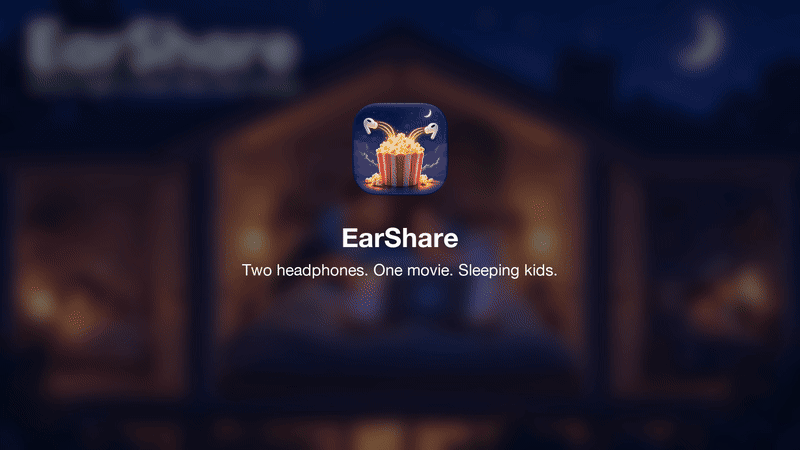

<p align="center"></p>

<h1 align="center"><br>EarShare</h1>
<p align="center"><b>Two headphones. One movie. Sleeping kids.</b></p>

## Why
The kids are finally asleep, and the two of you want to watch a movie — without the TV waking anyone up.
macOS only plays sound to **one** pair of headphones at a time. EarShare plays your Mac's audio on **both of your AirPods (or any headphones and speakers) at once**, each with its own volume.

## Features
- 🍿 Two (or more) AirPods, headphones or speakers playing together
- 🔊 Separate volume for each person
- 🔗 Connect paired Bluetooth headphones right from the menu bar
- ↩️ Stop puts your normal output back
- 🧠 Remembers your last pick
- No drivers, no kernel extensions — it uses macOS's own Multi-Output Device under the hood

## Install
<p align="center"><a href="https://github.com/pazaricha/EarShare/releases/latest/download/EarShare.dmg"><b>⬇️ Download EarShare.dmg</b></a></p>

1. Open **EarShare.dmg** and drag **EarShare** into **Applications**.
2. First launch: EarShare isn't notarized by Apple yet, so macOS will block it.
   Open it once, then go to **System Settings → Privacy & Security** and click **Open Anyway**.
   Or in Terminal: `xattr -dr com.apple.quarantine /Applications/EarShare.app`
3. Allow Bluetooth access when asked.
4. Look for the popcorn icon in your menu bar.

Requires macOS 14 (Sonoma) or later. Apple Silicon and Intel.

## Use
<p align="center"></p>

1. Click the popcorn icon in the menu bar.
2. **Connect headphones:** paired AirPods are listed with a Connect button.
3. **Tick who's listening:** tick both AirPods.
4. **Start:** press **Share sound with 2 outputs**.
5. Each of you sets your own volume. **Stop** when the credits roll.

## Good to know
- If an app uses an AirPods **microphone** (Zoom, FaceTime), those AirPods drop to low-quality call audio and may break the combo — use the Mac's mic instead.
- Bluetooth devices can drift a few milliseconds apart; macOS's drift correction keeps them in sync.
- If a device doesn't expose volume control, its slider is greyed out.

## Build from source
Needs only the Xcode Command Line Tools (`xcode-select --install`):
```bash
./build.sh
open build/EarShare.app
```

## Release
```bash
pip install dmgbuild
Tools/release.sh 1.2   # builds, makes EarShare.dmg + .zip, publishes the GitHub release
```

## License
MIT

How-to video music: "And So It Begins" by Artificial.Music, licensed under CC BY.
